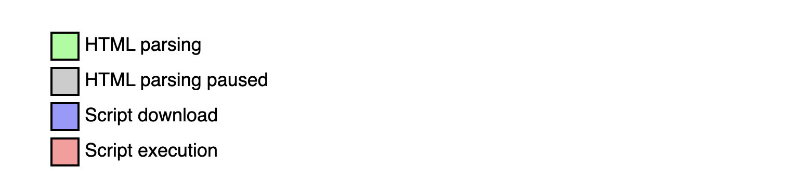

# sourcing .js files

We can, finally, move our JS code into separate files, ones with the .js extension. 

The `defer` and `async` attributes in `<script>` tags affect how JavaScript files load and execute which impacts page load times and the overall user experience.

For more information, check out: https://javascript.info/script-async-defer

## The OG

When you include a script without `async` or `defer`, the browser pauses HTML parsing to download and execute the script immediately upon reaching the `<script>` tag.

```html
<script src="./scripts/cool-script.js"></script>
```

## Defer

A cleaner way to get around the immediacy of the OG script tag is the `defer`. The `defer` attribute allows your script to download in the background while the HTML continues to parse:

```html
<script defer src="./scripts/cool-script.js"></script>
```

Why is this so neat? This is beneficial because the script waits until the entire HTML document is parsed before executing, and it runs in the order it appears in the DOM.

## Async

Alternatively, when you add `async` to a script, the script downloads in the background _without blocking HTML parsing_.

```html
<script async src="./scripts/cool-script.js"></script>
```

HOWEVER, the script executes as soon as it’s ready, _which may occur before the HTML document finishes parsing_.

## When do I use what?

Generally speaking:

- OG `script` tag 👉 Critical scripts that must run immediately, but rarely recommended unless you are in an intro to JS class and we are gradually learning different concepts
- `defer` attribute 👉 Scripts that need the "DOM to be ready" (e.g. anything that accesses the DOM)
- `async` attribute 👉 Independent scripts (e.g., analytics, ads, etc)

# Page Load Impact

Here’s a closer look at how different attributes impact page load using the below legend :)


## Defer


Loads the file in the background and runs JavaScript only when the DOM is ready, allowing you to retrieve HTML element objects in your script.

## Async


Loads the file in the background and runs JavaScript as soon as the file is loaded, potentially before the DOM is ready.

## The OG


Loads the file immediately, blocking the rest of the page until the script is executed, which may result in the DOM not being ready.

## Additional Resources

For a solid reference, you can visit [here](https://www.growingwiththeweb.com/2014/02/async-vs-defer-attributes.html#script)

# DOMContentLoaded Checks and Usage

## With Defer

When working with `defer`, the browser loads the script in the background and executes it after the HTML parsing is complete. This means you typically don’t need a `DOMContentLoaded` check. 

When should you use `defer`? For scripts that interact with the DOM, you can skip readiness checks unless you want to ensure other resources, like images, are also loaded. In that case, you might use `window.onload`. TLDR: `defer` scripts are _guaranteed to execute in order_.

## With Async

When using `async`, scripts load _independently_ and execute* as soon as they are downloaded*, which might happen before the DOM is fully loaded. THEREFORE, if your script needs to manipulate the DOM, a `DOMContentLoaded` check is necessary.

When is it best to use `async`? For scripts that do not depend on the DOM or other scripts, such as those intended for server-side operations or for managing cache or cookies.

