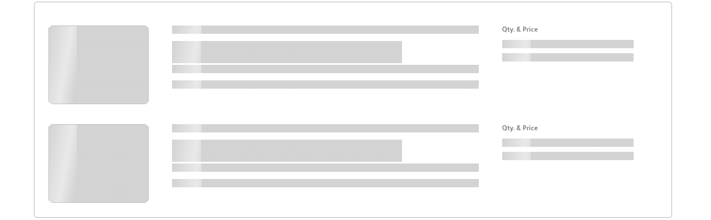

# Quick Recap

- What is a module?
  - It's a file that exports some code
- How do you export/ import your modules? You have two options:
  - ES Modules (modern syntax)
  - CommonJS (default in Node.js)
- What's the syntax for ESModules?

```js
// Named Module Export Statement
export const name = "value";

// Named Module Import Statement
import { name } from "...";
```

- What's the syntax for CommonJS?

```js
// CommonJS Import Statement
const { name } = require("...");

// CommonJS Export Statement
module.exports = { name };
```

- Which syntax should I use? It depends.
  - If you are working with modern JavaScript frameworks or libraries, such as React or Vue, the recommended approach is to use `import` for modules.
  - If you are maintaining older projects or working on projects that need to be backwards compatible, then using `require` is the preferred method.
- Can I use the modern syntax right away? No
  - You need to make modifications to your `package.json`

```json
{
  "type": "module" // add me to your package
}
```

- Do I need to know both methods? Yes

# Common Module problems and how to fix them

## Cannot use import statement outside a module

If you encounter an error message like this:

```text
import { myModule } from "some/link/to/myModule";
^^^^^^

SyntaxError: Cannot use import statement outside a module
```

This indicates that you need to configure your `package.json` with the following line:

```json
{
  "type": "module" // add me to your package
}
```

## Cannot find module

If you see an error similar to this:

```text
Error [ERR_MODULE_NOT_FOUND]: Cannot find module 'node-app/some/link/to/myModule' imported from node-app/index.js
Did you mean to import ../utils/myModule.js?
```

Make sure that the file path in your import statement is correct. If your paths still do not work, ensure that your import statement ends with `.js`, like so:

```js
import { myModule } from "./utils/myModule.js"; // notice the extension
```

The extension is necessary for ESmodules in Node.js.


# Lazy Loading

## What is it?

Lazy loading is a design pattern or technique used to defer the loading of resources (like images, scripts, or data) until they are actually needed instead of loading everything upfront.

## Why does it matter?

```js
Performance++;
Cost--;
```

- Faster Page Load Times 👉 smaller web pages load faster and this leads to a better user experience.
- Reduced Bandwidth Usage 👉 lazy loading ensures that only the content users interact with or scroll to is downloaded. Cloud hosting services might charge based on number of bytes transferred on every request and now you are making less requests :^)

## Real World Example

You know when you go to access a [youtube](https://www.youtube.com/) and you sometimes get a bunch of grey boxes? This is because the content is being loaded lazily. The official name for these fun grey boxes is a _skeleton loader_ and it acts as a visual placeholder that mimics the layout of the content that is still being loaded lazily.



## Practical example

In modern HTML, you can use the `loading="lazy"` attribute for images:

```html

```

# Simulating Bad Wifi

We are going to force [Youtube](https://www.youtube.com/) to load lazily slower so you can appreciate the concept.

- Open up Chrome DevTools
- Go to the Network tab
- At the top of the Network tab, you’ll see a dropdown menu labeled `No throttling`.
- Click this dropdown, and you’ll see several predefined options to simulate different network speeds:
  - Fast 4G
  - Slow 4G
  - Offline
- For this example select `Slow 4G`
- Now refresh the page, what happens?

# Intersection Observer API

To lazy load audio, video and visual content, you need to know about the [IntersectionObserver](https://developer.mozilla.org/en-US/docs/Web/API/Intersection_Observer_API).

## What is it?

The Intersection Observer API is a browser feature that allows you to detect when an element enters or leaves the visible part of the screen (the viewport). It helps you efficiently manage tasks related to visibility, such as lazy loading images or triggering animations when elements come into view.

## Why use it?

Taken directly from the official docs, it is used for these main reasons:

- To implement "infinite scrolling"
- To reporting of visibility of advertisements in order to calculate ad revenues.
- To decide whether or not to perform tasks or animation processes based on whether or not the user will even see it.

## The General Formula

Step 1) Create an Intersection Observer by specifying a callback function that runs whenever the target elements enter or leave the viewport.

```js
const observer = new IntersectionObserver(handleIntersect);
```

Step 2) You tell the observer which elements you want to monitor

```js
observer.observe(someElement);
```

Step 3) The observer keeps track of the visibility of these elements. When observer `observe`s a change in the element's intersection status, the function you define in `handleIntersect` will be called

```js
// An array will be passed into the function when the observer calls it
const handleIntersect = (entries) => {
  entries.forEach((entry) => {
    if (entry.isIntersecting) {
      // do some cool stuff
    }
  });
};
```

The function will be called by the observer when any of the observed elements’ intersection status changes.

## Using data-* to store information on an HTML element

In HTML, you can add any attribute starting with `data-` to your tag. You can name it whatever you like (e.g., `data-user-id`, `data-role`).

```html
<button id="myButton" data-user-id="254567" data-user-role="admin"  data-status="active">
  View Profile
</button>
```

In JavaScript, you can retrieve this data from the HTMLElement object:

- on the `dataset` property
- the `data-`  is dropped on the sub-property and any dashes are converted into CamelCase.

For example: the HTML `data-user-id`, in JavaScript, is accessed on the element object as `myElement.dataset.userId`

```javascript

const button = document.getElementById('myButton');

// Access the data from the dataset object property
const userId = button.dataset.userId;     // Converts data-user-id to userId
const userRole = button.dataset.userRole; // Converts data-user-role to userRole
const status = button.dataset.status;     // Converts data-status to status

console.log(userId);   // "254567"
console.log(userRole); // "admin"
console.log(status);   // "active"
```


## Where do I store the real src of the image?

We only want to load the content when the user scrolls to it. Let's use the `IntersectionObserver`.

```html
<!DOCTYPE html>
<html lang="en">
  <head>
    <meta charset="UTF-8" />
    <meta name="viewport" content="width=device-width, initial-scale=1.0" />
  </head>
  <body>
    <div style="height: 100vh">Scroll down to the image.</div>

    

    <script>
      // Step 1: Wait for the DOM
      document.addEventListener("DOMContentLoaded", function () {
        // Step 2: Get the img element by its ID
        const myImage = document.getElementById("theImage");

        // Step 3: Get the data-src value: in JS, on the HTMLElement object, 
        // it is in the property dataset, an object. It has a property src.
        console.log( "" );

        // Step 4: Define the callback
        const handleIntersect = (entries) => {
          entries.forEach((entry) => {
            // Step 5: Check if the img element is intersecting (visible in the viewport)
            if (entry.isIntersecting) {
              // Step 6: Set the src of the img from the data attribute

            }
          });
        };

        // Step 7: Create an Intersection Observer with the defined callback
        const observer = new IntersectionObserver(handleIntersect);

        // Step 8: Start observing the img element
        observer.observe(myImage);
      });
    </script>
  </body>
</html>
```

Solution:

```html
<!DOCTYPE html>
<html lang="en">
  <head>
    <meta charset="UTF-8" />
    <meta name="viewport" content="width=device-width, initial-scale=1.0" />
  </head>
  <body>
    <div style="height: 100vh">Scroll down to the image.</div>

    

    <script>
      // Step 1: Wait for the DOM
      document.addEventListener("DOMContentLoaded", function () {
        // Step 2: Get the img element by its ID
        const myImage = document.getElementById("theImage");

        // Step 3: Get the data-src value: in JS, on the HTMLElement object, 
        // it is in the property dataset, an object. It has a property src.
        console.log( myImage.dataset.src );

        // Step 4: Define the callback
        const handleIntersect = (entries) => {
          entries.forEach((entry) => {
            // Step 5: Check if the img element is intersecting (visible in the viewport)
            if (entry.isIntersecting) {
              // Step 6: Set the src of the img from the data attribute
				entry.target.src = entry.target.dataset.src
            }
          });
        };

        // Step 7: Create an Intersection Observer with the defined callback
        const observer = new IntersectionObserver(handleIntersect);

        // Step 8: Start observing the img element
        observer.observe(myImage);
      });
    </script>
  </body>
</html>
```


***Note!***   Why should I not use `myImage` in the `handleIntersect` function?

​	You must rely on the array your function is passed. What if you had many images observed?


## How do I customize the intersection behaviour?

Pass an option object when instantiating your `IntersectionObserver`.

```javascript
const options = {  root: null,  rootMargin: '0px',  threshold: 0.0 }; 
const observer = new IntersectionObserver(callback, options);

```


# Activity

- Download a complete audio `.mp3` file from the internet.
- Create an HTML page with some images and lower down, an audio element.
- Store the location of the .mp3 in the data-src attribute of the audio element.
- Using the `IntersectionObserver` set up your page to play the audio when the halfway mark of the audio-element is reached.
