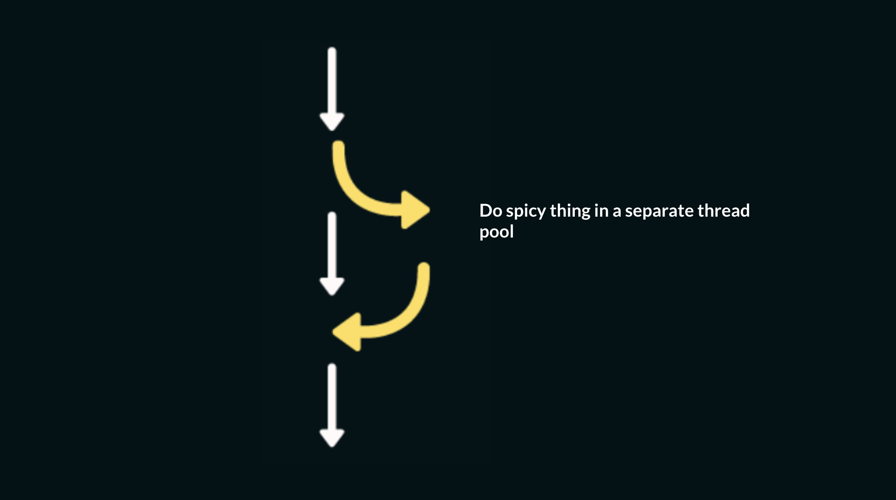
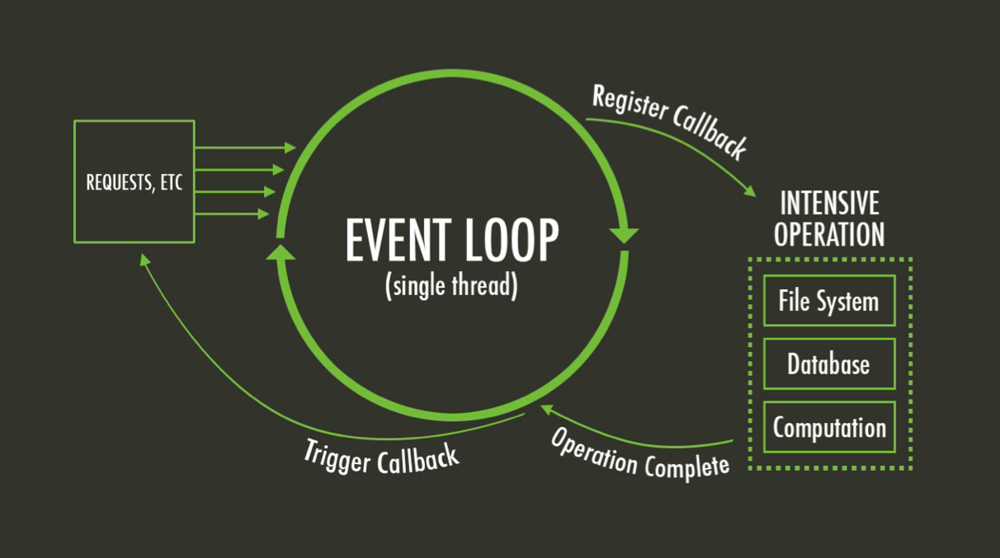
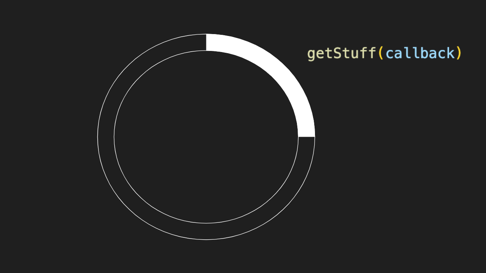
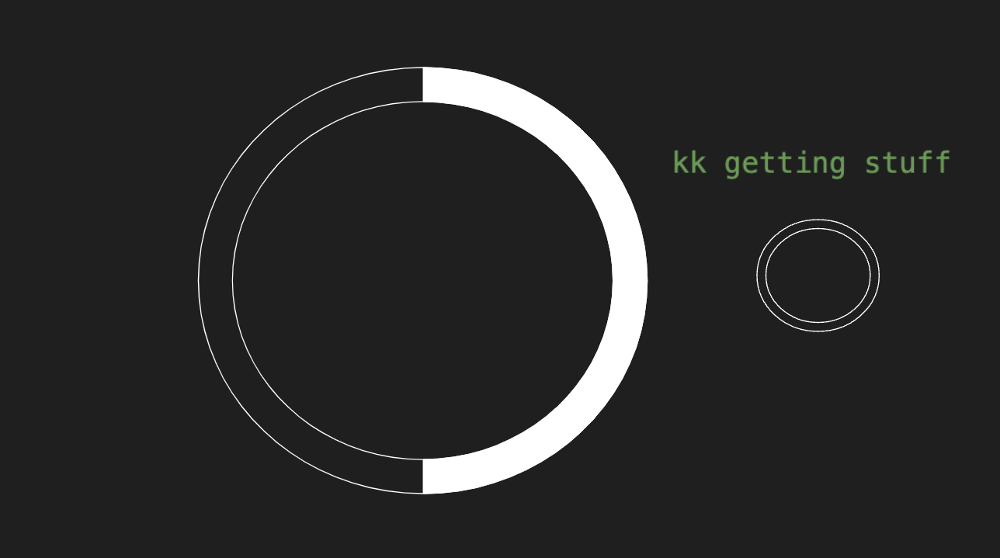
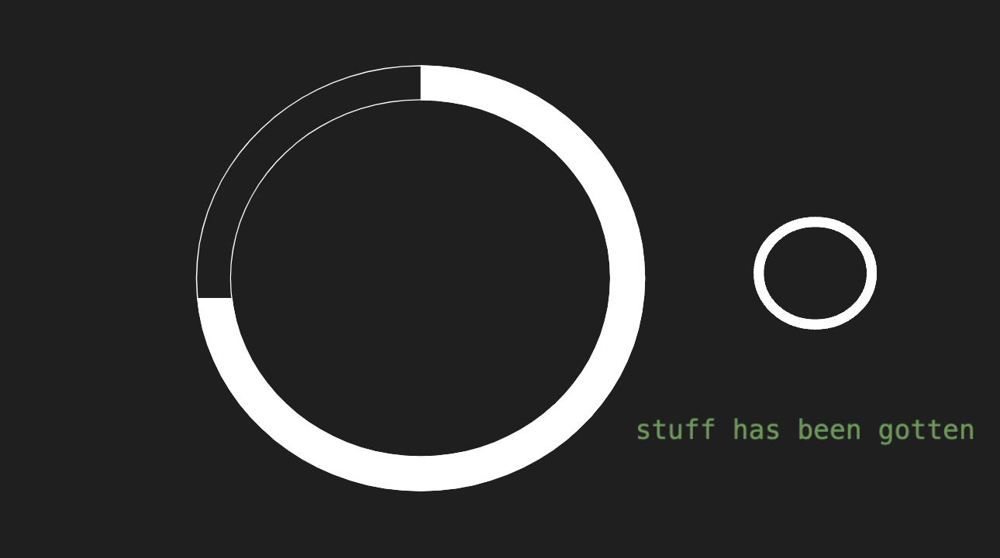
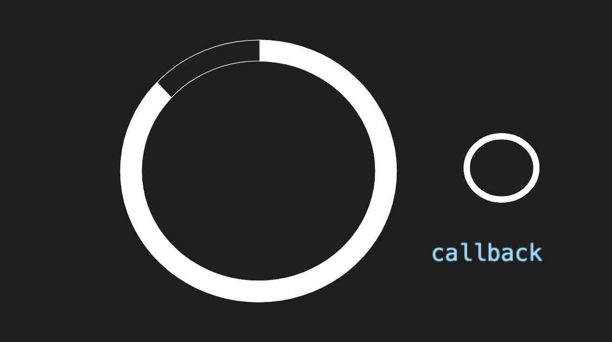
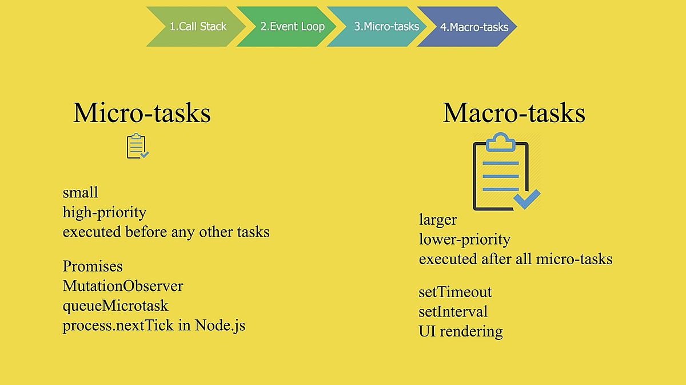
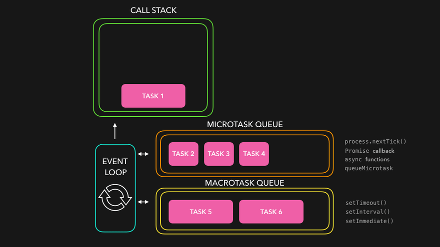
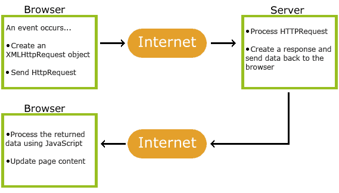

# Debugging tips and reminders

- Look for errors in the console. If there are errors, don’t just ignore the specifics and go back to your code trying to guess what went wrong. 
  - Look at the error, read it carefully. What is it saying? Something is undefined? What is it saying is undefined? You are accessing something on something that is null? What is it saying is null?
  - Look at the line the error is reported on. Look at the code on that line with the error description in mind.
- Add breakpoints / console logging
  - To add breakpoints: open the inspect tools, go to the Sources tab, open your .js file, click on the line number to add a breakpoint. Refresh the page so that your JS code is run again and your breakpoint is reached.
- Take a close look:
  - Is the variable defined in the enclosing scope?
  - Am I accessing something on an object that does not have such a property/method? Did I just kind of guess the property/method without really inspecting the object?
  - Is the object I am accessing what I think it is (array vs element object, etc)? Add a breakpoint and hover over it or console log it. Inspect your code. 
  - Am I assuming an incorrect type?


# Asynchronous Programming

Async programming allows code to execute without blocking the main thread, enabling other operations to continue while waiting for other tasks to complete.

## How does this relate to Web Development?

This is especially important in web development to avoid freezing or slowing down a page while waiting for resources from a server.

## In the context of Web Development, what is the main thread?

In the context of web development, the main thread refers to the single thread where most of the execution of JavaScript, rendering of HTML/CSS, event handling, and general browser operations occur.

## What blocks the main thread?

JavaScript is traditionally single-threaded, meaning it runs one task at a time on the main thread. However many things we do in the web tend to be time consuming or "blocking" causing the browser to freeze or become unresponsive.

## What are common blocking operations?

Synchronous tasks (like loops or long computations) can block the main thread, preventing it from doing other work. Some examples include:

- Long loops and complex calculations
- Modifying the DOM and heavy DOM traversal (e.g. animations)
- Any synchronous file operations (e.g. reading large files using local file access)
- Parsing Large JSON

## How does Async Programming help?

To prevent blocking the main thread, web developers use asynchronous programming to offload tasks that can take time, such as `fetch`ing data from a server or performing complex calculations.



## Why is this so useful?

The browser can continue to render and respond to user interactions while the task completes in the background.

# Async Programming and the IntersectionObserver API

## Why does async programming relate to the IntersectionObserver API?

The Intersection Observer API allows you to "asynchronously" observe changes in the intersection of a `target` element within a viewport. The main benefits include and are not limited to:

- Non blocking behavior
- Efficient Resource Loading

## Non-blocking Behavior

The Intersection Observer API performs asynchronous observation of elements. You specify what to `observe()`

```js
observer.observe(someElement);
```

When the conditions are met (like an element entering the viewport), a "callback" is triggered.

```js
const observer = new IntersectionObserver(callback);
```

This happens asynchronously, without blocking the main thread which improves performance.

## Efficient Resource Loading

The Intersection Observer can delay the loading of certain resources, such as images, until they are actually needed:

```js
function callback(entries, observer) {
  entries.forEach((entry) => {
    if (entry.isIntersecting) {
      // Get the image
      let img = entry.target;
      // Set the URL to be a local file
      img.src = img.dataset.src;
      // Stop observing once image is loaded
      observer.unobserve(img);
    }
  });
}
```

However there is much more to this. Today we are going to explore stuff beyond lazy loading of images and see how async programming is implemented in the rest of JavaScript.

To understand anything async, we need to take a moment to appreciate the event loop.

# The Event loop

Both the browser and Node.js are always running a single-threaded event loop to run your code.



On its first pass, the event loop runs all your "synchronous" code. However, it also manages "asynchronous" events by placing them in a queue to be handled later, without blocking the main thread. Let’s break this down with an example.

## Example Scenario

Imagine you need to run a function called `getStuff`, but first, you need to "fetch" some data from the server.



Here, the event loop says: "ok sounds good, function, I'll keep doing my thing while you go do your thing"



Your function, `getStuff()`, goes off to fetch the data. This happens in the background (often in a separate thread pool).



At some point in the future, when the server responds, `getStuff()` completes and notifies the event loop that it’s ready to be "called back"



It is at this point where things start to get a bit more complicated. Depending on the type of task, the event loop handles the callback in different ways:

- If it's a _macro task_ (e.g., a big task), it will run in the next iteration of the event loop.
- If it's a _micro task_ (e.g., a small task), it will run before the next iteration of the event loop.

What does this all mean? This will make (hopefully) more sense in the code.

# The Code behind the Loop

Let's run the following code in "Run and Debug" mode and add breakpoints to each line:

```js
console.log("I am a synchronous task"); // 1

setTimeout(() => console.log("short timeout"), 0); // 2

Promise.resolve().then(() => console.log("what is a promise?")); // 3

console.log("I am also synchronous"); // 4
```

At first glance, you might expect these tasks to execute in the order they're written (1, 2, 3, 4), but that’s not actually the case. The order in which they run is actually 1, 4, 3, 2, as demonstrated below:

```text
I am a synchronous task
I am also synchronous
what is a promise?
short timeout
```

## What is happening?

To understand the order of execution, you need to know the difference between synchronous tasks, micro tasks, and macro tasks.



## Synchronous Tasks

These tasks block the event loop, meaning the next task cannot be executed until the current one is completed. For example:

```js
console.log("I am a synchronous task");
console.log("I am also synchronous");
```

## Asynchronous Macro Tasks

These tasks have their callbacks executed in the next iteration of the event loop, after all synchronous code and micro tasks are completed.

Examples of macro tasks:

- `setTimeout`
- `setInterval`
- `observe`
- event listeners

In our example:

```js
setTimeout(() => console.log("short timeout"), 0);
```

Even though the timeout is set to 0, this is a macro task and is deferred until the next loop cycle.

## Asynchronous Micro Tasks

These are smaller tasks that run before the next iteration of the event loop. They don’t block the execution, but take priority over macro tasks.

Some "Micro" Tasks include:

- `Promise` resolutions

In our example:

```js
Promise.resolve().then(() => console.log("what is a promise?"));
```

This micro task runs after the synchronous code but before any macro tasks.


## Visual Aid

If you're still confused, here’s a lovely `gif` to help illustrate how tasks are processed:



# AJAX

## How can we make server requests?

For the purposes of this class, we will be learning how to use AJAX to make requests to a server.

## What is AJAX?

AJAX (Asynchronous JavaScript and XML) allows web applications to send and retrieve data from a server asynchronously.

## How does it work?



Why is this so neat? It allows parts of web pages to be asynchronously updated without reloading the whole page.

## How do you make a server request with AJAX?

The browser sends a request to the server via JavaScript, typically using the `XMLHttpRequest` object or using the more modern `fetch` API.

When you make a request to the server, you are being "promised" by that server that it will get the data you desire.

## How is that response consumed?

Once you get that response, it is consumed as a "Promise" with the contents of that message containing the data that was "requested".

## What happens to the Webpage?

Once JavaScript has finished processing the response, it updates specific parts of the webpage dynamically.

## Docs

You can read more about it [here](https://www.w3schools.com/xml/ajax_intro.asp)

# XMLHttpRequest

All modern browsers have a built in XMLHttpRequest object:

```js
let xhttp = new XMLHttpRequest();
```

## GET requests

If I want to make a GET request to a server using this object, it would be as follows:

```js
xhttp.open("GET", "<url>", true); // true ~ asynchronous
xhttp.send(); // send request
```

## Example

Let's explore the following:

```js
let requestURL =
  "https://mdn.github.io/learning-area/javascript/oojs/json/superheroes.json";
let request = new XMLHttpRequest(); // create the object

//set the URL to retrieve info from
request.open("GET", requestURL, true); 

//set the function that should be run when the response is received
request.onload = function () { 
      let superHeroes = request.response; //the JSON string from the response
      console.log(superHeroes);
    };

request.send();

console.log( superheroes );
```

As a reminder:

- `open()` prepares a request to an API endpoint
- `onload` processes the response if successful (and `onerror` handles failures)
- `send()` sends the request

# JSON <=> JavaScript object

JSON - JavaScript Object Notation

- a standard text-based format for representing structured data.
- based on JavaScript object syntax, 
  - but independent of JavaScript (could be used anywhere)
- often used to transfer data from web server to browser (client).
- is a string (great for transfer)
- JavaScript provides a JSON object with methods to convert it to a JavaScript object.

When you have a JSON string (from the xhr.response, after a request that responds with JSON, for example), use `JSON.parse` to convert it into a JavaScript object:

```javascript
const myJSObject = JSON.parse( myJSONString );
```

You can also go from a JS object to a JSON string: 

```javascript
const myJSONString = JSON.stringify( myJSObject );
```

- JSON requires **double quotes** to be used **around property names and values that are strings**. Single quotes are not valid.

- Even a single misplaced comma or colon can cause a JSON file to go wrong.

  

# Exercise 1

Using an XMLHttpRequest object, retrieve and display for the user: the most probable country id for any name the user of your webpage enters into a textbox. 

Create a textbox with a button (do not use a form here since we want to remain on the page and update it with information).

When the user clicks the button, use the XHR to make an HTTPRequest to [https://api.nationalize.io](https://nationalize.io/). Look at the API documentation to see the GET parameters to send in the URL. 

example: https://api.nationalize.io/?name=michael&apikey=d111c2870371b078487afe38fb9066c4


# Exercise 2

Using an XMLHttpRequest object, retrieve and display for the user:

the topic and highlight from the 1st result received on https://www.edgechat.ai/mcp

Go to the Dev link and figure out the URL you would use to give encyclopedia results to your user for anything they want to search.


```html
<!DOCTYPE html>

<input type="text" id="theSearch"/>
<button>Search</button>
<h2 id="categoryLabel">The category of your item is:</h2>
<h3 id="category"></h3>

<h2 id="infoLabel">Information on your item:</h2>
<h3 id="info"></h3>
<script>

    "use strict";
    document.addEventListener("DOMContentLoaded", ()=>
    {
        
        //your code here!
        
    });

</script>
```

## Using fetch

The fetch API is a modern alternative to `XMLHttpRequest` that simplifies the syntax for handling AJAX requests. It is "promise-based", making it more intuitive to work with asynchronous data:

```js
// Step 1 👉 Init a fetch request
fetch("https://pokeapi.co/api/v2/pokemon/ditto")
  // Step 2 👉 Handle the response once retrieved
  .then((response) => {
    // Step 3 👉 is the response NOT trash?
    if (!response.ok) {
      // Step 4 👉 error if trash
      throw new Error("TRASHHHHHHHHH: " + response.statusText);
    }
    // Step 5 👉 parse JSON if not trash
    return response.json();
  })
  // Step 6 👉 now handle JSON
  .then((data) => console.log(data))
  // Always good to add error handling
  .catch((error) => console.error("Please observe the trash:", error));
```

With `fetch`, data handling is a bit more straightforward:

- The `.then()` blocks handle success and parse the JSON response.
- `.catch()` manages errors, making the code easier to follow and debug.

We will cover the idea of `promises` more next class, for now, get comfy making API requests.


# Async Operations Summary

Today we discussed the following async operations:

- Callbacks 👉 Functions passed as arguments that are executed once a task is completed.
- `Promise`s 👉 Objects representing a future result of an async operation, which can be resolved or rejected.

We will later cover `async` and `await` which is just a more readable syntax for working with Promises
